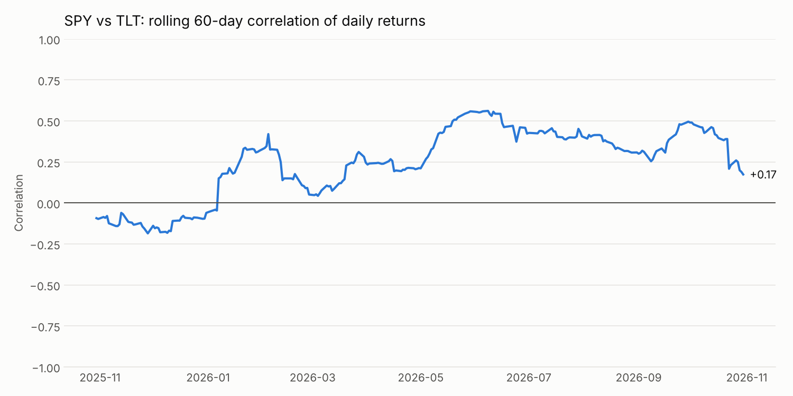

# SPY / TLT rolling correlation

Downloads the last year of daily closes for SPY (stocks) and TLT (long Treasury bonds),
then plots the rolling 60-day correlation of their daily returns.



*Example output, generated 2026-10-30. Rerun the script for current data.*

## Run

```bash
pip install -r requirements.txt
python spy_tlt_corr.py
```

This saves `spy_tlt_corr.png` and prints the latest, average, lowest and highest correlation.

## Notes

- Correlation is computed on daily returns, not raw prices (raw prices trend and overstate correlation).
- Closes are dividend-adjusted.
- Data comes from Yahoo Finance via `yfinance`, an unofficial scraper. Yahoo's terms limit use to personal purposes.
